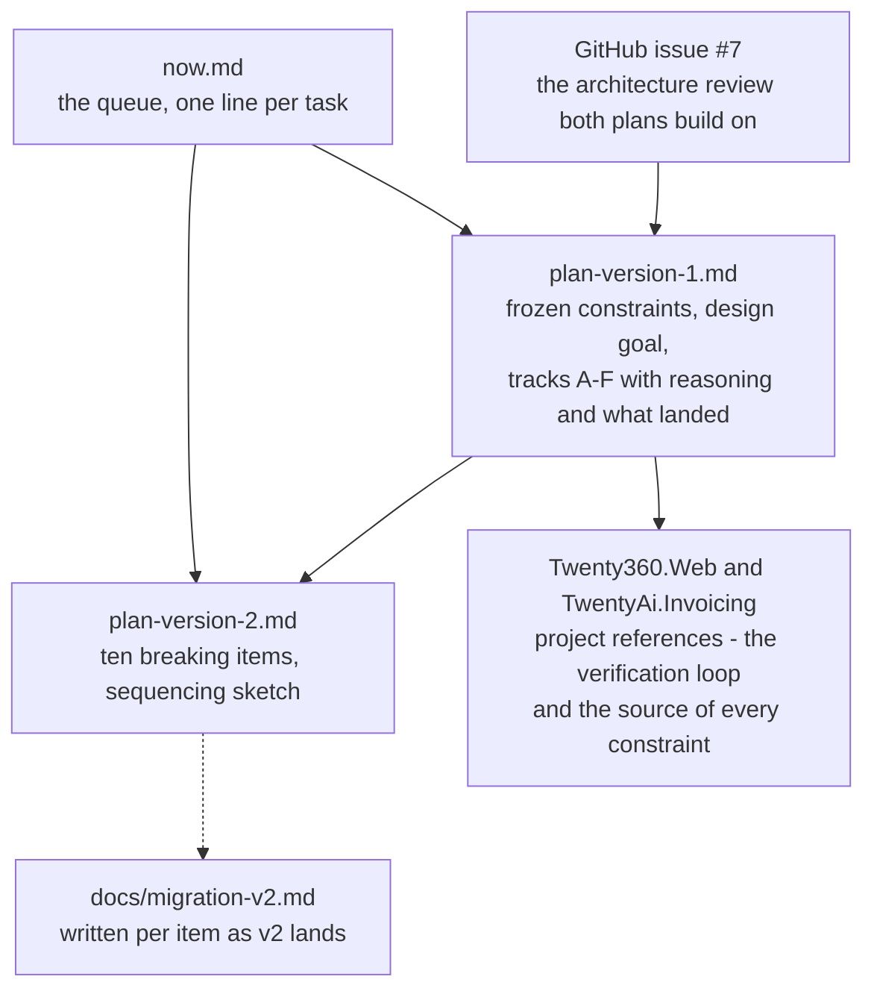

# Now

The one page to open first. Section 1 is the queue in the order I think it should go; section 4 is what left
the queue. Everything deeper is a link into [plan-version-1.md](plan-version-1.md) (non-breaking 1.x) or
[plan-version-2.md](plan-version-2.md) (breaking 2.0). Updated 2026-09-21.

> **Reprioritised by Vaclav:** (nothing yet - write a line here when you reorder, and I follow it)

⬜ not started · 🟡 in progress · ⏸ waiting on a decision or on someone else · ✅ done

Every item ends the same way: warning-clean build, `dotnet test`, the affected sample pages clicked through on the
Server head, and both consumer apps built. Then it stops and waits for Vaclav's pass - no bUnit, by agreement
([working agreement](plan-version-1.md#working-agreement)).

## 1. Queue - version 1.x

- ⬜ **D3 `QuickGridToolkitOptions` via DI** - default tick classes, date format, `ItemsPerPage`, table `Class`;
  deletes `AddTickColumn2` from both apps. D15 solved the precedence half; decide how the defaults reach
  `ColumnBuilder` before coding. → [Track D](plan-version-1.md#track-d--non-breaking-api-additions), and the
  [design goal](plan-version-1.md#design-goal--shrink-the-appquickgrid-burden) it serves.
- ⬜ **F4 global options + custom tick icons example** - rides on D3.
  → [Track F](plan-version-1.md#track-f--samples--docs)
- ⬜ **D4 `SearchVisibleColumnsOnly`** - one line onto the `SearchOptions` baseline now; settle the two meanings of
  "excluded" while there. → [Track D](plan-version-1.md#track-d--non-breaking-api-additions)
- ⬜ **D12 leftover: `IsStyleEnabled` on the simple-column path** - `ColumnBuilder.cs:89`, one line plus a test.
  → [Track D, D12](plan-version-1.md#track-d--non-breaking-api-additions)
- ⬜ **D2 stable column `Key`** - saved views survive a title rename; `FullTitle` fallback for persisted configs;
  groundwork for v2 item 4. → [Track D](plan-version-1.md#track-d--non-breaking-api-additions)
- ⬜ **C3 footer as a RenderFragment** - Blazor owns the `<tfoot>`, JS moves the node; retires B3 and the
  `innerHTML` cache dance. Manual pass on every footer page.
  → [Track C](plan-version-1.md#track-c--internal-architecture-non-breaking-issue-7-items-1-3-8-10)
- ⬜ **C4 compiled accessors + E4 `SearchValues`** - the search hot path; measure before and after; take the two
  #6 leftovers with it.
  → [Track C](plan-version-1.md#track-c--internal-architecture-non-breaking-issue-7-items-1-3-8-10),
  [Track E](plan-version-1.md#track-e--c-14--net-10-modernization)
- ⬜ **B6 + F1 `FilterCriteria` path** - build the EF sample first, then harden the code it runs; flip the pinned
  defect test in `GridSearchTests`. → [Track B](plan-version-1.md#track-b--correctness-fixes),
  [Track F](plan-version-1.md#track-f--samples--docs)
- ⬜ **D5 `ResetSortAsync()`** - Twenty360 unmounts the whole grid to clear a sort.
  → [Track D](plan-version-1.md#track-d--non-breaking-api-additions)
- ⬜ **D6 declarative footers + F3 example** - replaces Twenty360's three hand-rolled loops (two with live bugs).
  → [Track D](plan-version-1.md#track-d--non-breaking-api-additions), [Track F](plan-version-1.md#track-f--samples--docs)
- ⬜ **D7 post-render hook** - `OnGridReady`; removes both consumers' `Task.Delay` workarounds.
  → [Track D](plan-version-1.md#track-d--non-breaking-api-additions)
- ⬜ **D9 complete `Events` + D10 CSV export out of the box** - the other half of the design goal; binding pairs stay
  flat. → [Track D](plan-version-1.md#track-d--non-breaking-api-additions)
- ⬜ **D8 obsolete the dead API** - feeds v2 item 10; delete the commented-out blocks and `background.png` outright.
  → [Track D](plan-version-1.md#track-d--non-breaking-api-additions)
- ⬜ **`data-content` dual-emit** - a v2 cut-over that has to *start* in late 1.x: emit both attributes, move samples
  and docs to `data-content`. → [v2 item 6](plan-version-2.md#6-wrapper-decomposition--ui-modernization)
- ⬜ **F5 search example, remaining bits** - after D4: visible-columns-only, an `ExactMatch` preset, `addToContent`
  columns. → [Track F](plan-version-1.md#track-f--samples--docs)
- ⬜ **F6 dark-mode sticky header** - `var(--bs-body-bg)`; document or drop `btn-xs`.
  → [Track F](plan-version-1.md#track-f--samples--docs)
- ⬜ **E1-E3, E5 modernization** - only where it simplifies, as the code is touched anyway.
  → [Track E](plan-version-1.md#track-e--c-14--net-10-modernization)
- ⏸ **Vaclav's calls** - `LICENSE.txt` still has the MIT placeholders (before any NuGet publish)
  [A3](plan-version-1.md#track-a--foundations); `CLAUDE.md` says "11" example pages, there are 12; whether
  `AddRange` stays prominent in the samples [B5](plan-version-1.md#track-b--correctness-fixes).

## 2. Queue - version 2.0 (breaking; after 1.x is where it needs to be)

Sequence from the [sketch](plan-version-2.md#sequencing-sketch): the two structural breaks first, then the contract
changes, then the feature work. Every item ships with its `docs/migration-v2.md` section.

- ⬜ **1. Self-rendering columns** - `DynamicColumn.Render()`, 34 `ColumnType =` sites in Twenty360 to migrate.
  → [v2 §1](plan-version-2.md#1-self-rendering-columns-issue-7-2)
- ⬜ **3. Overload collapse on `ColumnManager`** - implicit `string → ColumnInfo`, keep `AddSimple`, normalize the
  parameter matrix (table first). → [v2 §3](plan-version-2.md#3-overload-collapse-on-columnmanager-issue-7-4)
- ⬜ **2. Data-source split `Items` / `QueryableItems`** - design jointly with 7 and 8 as `GridDataSource<T>`.
  → [v2 §2](plan-version-2.md#2-data-source-split-items--queryableitems-issue-7-7)
- ⬜ **4. `Key` everywhere** - footers, saved views, export; migration helper for persisted views.
  → [v2 §4](plan-version-2.md#4-column-identity-key-everywhere-issue-7-6-phase-2)
- ⬜ **5. Saved views as a contract** - `IColumnConfigStore`, clean `ColumnConfig`, column reordering.
  → [v2 §5](plan-version-2.md#5-saved-views-as-a-first-class-contract)
- ⬜ **6. Wrapper decomposition** - sub-components, localization, CSS variables and dark mode, `data-content`
  cut-over, drop the obsoleted flat parameters (`IsNestedSearch`, the D9 pair).
  → [v2 §6](plan-version-2.md#6-wrapper-decomposition--ui-modernization)
- ⬜ **7. Virtualization / `ItemsProvider`** - design note first; the largest net-new feature.
  → [v2 §7](plan-version-2.md#7-virtualization--itemsprovider-support)
- ⬜ **8. `ItemsVersion` ergonomics** - `GridDataSource<T>` with change notification; `ItemsVersion` stays.
  → [v2 §8](plan-version-2.md#8-itemsversion-ergonomics)
- ⬜ **9. Icon provider v2** - base class with per-icon virtuals; honour `extraCss`.
  → [v2 §9](plan-version-2.md#9-icon-provider-v2)
- ⬜ **10. Removals** - everything D8 obsoleted, the `ColumnType` shim, `Id`-keyed footers; re-verify against both
  consumers at the time. → [v2 §10](plan-version-2.md#10-removals-everything-obsoleted-in-v1-d8)
- ⏸ **Review `AddRange`** - keep and de-emphasize, or obsolete; decide at v2 time, not before.
  → [v2](plan-version-2.md#review-addrange-decide-do-not-assume)

## 3. How the docs connect

## 4. Done

- ✅ **A1-A5 foundations** (2026-08) - test project, CI with warnings as errors, NuGet metadata (pack only),
  `.editorconfig`, doc paths fixed.
- ✅ **B1-B4 quick fixes** (2026-08) - dead Manage Columns button, dropped `ColumnInfo.PropertyName`, unencoded
  footer HTML, missing `ClearSearch` icon.
- ✅ **B7 icon-provider resilience** (2026-08) - a consumer provider that throws on a new icon no longer crashes the
  grid; lifted frozen constraint 8.
- ✅ **B5 + F2 `AddRange` / `Clone()`** (2026-08-19) - copies on add, runtime type preserved, `SimpleClone()`
  fixed for its one production caller; extension methods documented as the way to share columns.
- ✅ **C1 pure `VisibleItems`** (2026-08-19) - no more side effects in a getter; a changed `Items` reference is not a
  recompute trigger, by design.
- ✅ **C2 `GridSearch<T>` + `GridFooterBuilder<T>`** (2026-08-19) - wrapper down to 598 lines, footer alignment under
  test; the "cache what you compute, never a parameter" lesson after a Twenty360 regression.
- ✅ **D11 `ValueStyles`** (2026-08-19) - per-manager opt-out of the value colour spans.
- ✅ **C5 parse once per search** (2026-08-21) - `PrepareTerms`/`Matches`; equivalence test.
- ✅ **D1 `Add*` returns the column** (2026-08-21) - source-compatible across ~1,300 call sites; subtype preserved.
- ✅ **D12 value colours out of the toolkit CSS** (2026-08-21) - the palette is the app's; the selector stays the
  contract.
- ✅ **D13 `RefreshColumnsAsync()`** (2026-08-24) - one public call for columns changed outside the wrapper; fixed the
  built-in selector's missing-tooltip bug on the way. Sample `/column-visibility`.
- ✅ **F9 example count on both heads** (2026-08-24) - nav, home, `Example n of N`.
- ✅ **D14 `-word` exclusions** (2026-08-25, Vaclav) - `EnableExclusionTerms`, `SearchTerm`, 10 tests.
- ✅ **D15 `SearchOptions` parameter** (2026-08-26) - every `QuickSearchOptions` knob reachable per grid, live,
  compared by value; `IsNestedSearch` obsoleted; `MaxSearchDepth` back to 1; Invoicing migrated.
- ✅ **F7, F8 samples on GitHub Pages + README table** (2026-08) - shared RCL, Server and WebAssembly heads.
- ✅ **xunit.v3** (2026-09-21) - 4.0.1 on Microsoft.Testing.Platform via the root `global.json`; CI on
  `dotnet test --solution`; 165 tests.
